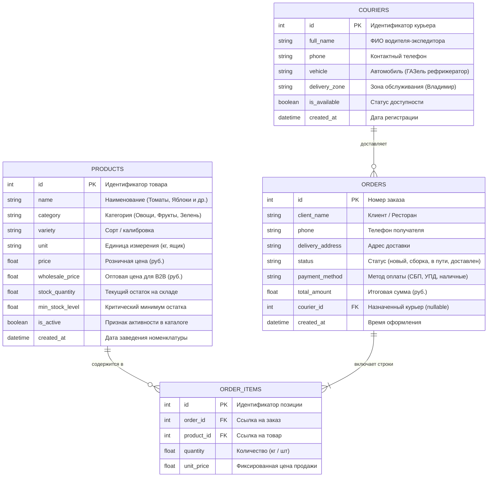
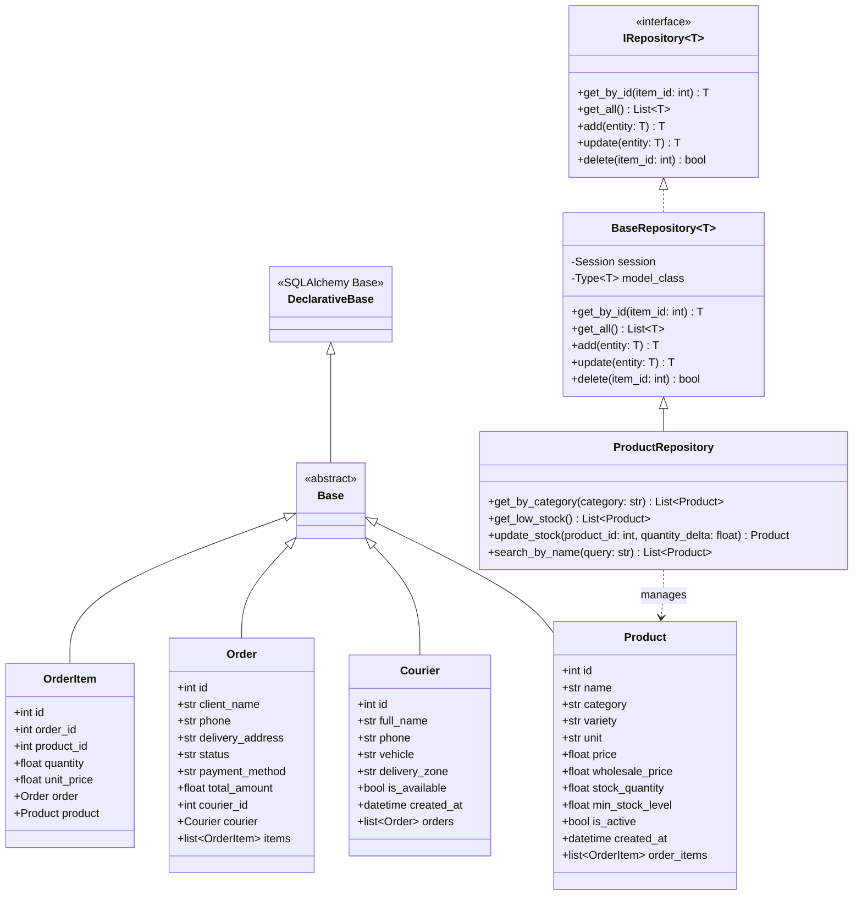

# Лабораторная работа: ORM, Паттерн Repository и миграции Alembic
## Дисциплина: «Командное проектирование и разработка»
**Студент:** Мартиросов Валерий  
**Группа:** ПИ-123, ВлГУ  
**Тема ВКР:** «Интегрированная информационная система складского учета, комплектации и доставки плодоовощной продукции ООО «Микс» (г. Владимир)»

---

## 📌 1. Цель и решаемые задачи
Цель работы — спроектировать объектно-реляционную модель данных (ORM), внедрить паттерн **Repository** и настроить систему версионирования схемы базы данных с помощью **Alembic** для бэкенда информационной системы оптово-розничной базы ООО «Микс».

### Выполненные задачи:
1. Выбран технологический стек: **Python 3.12**, **SQLAlchemy 2.0** (современный декларативный синтаксис `Mapped` / `mapped_column`), **Alembic**, **SQLite**.
2. В каталоге `app/models/` описаны сущности предметной области (товары `Product`, заказы `Order`, спецификации `OrderItem`, курьеры-экспедиторы `Courier`).
3. В каталоге `app/repositories/` реализован паттерн **Repository** (`IRepository`, `BaseRepository`, `ProductRepository`) с базовым CRUD и специализированной бизнес-логикой контроля неснижаемых остатков (`get_low_stock`) и складского учета (`update_stock`).
4. Настроена фабрика сессий и подключение к БД в `app/database.py`.
5. Инициализирован и сконфигурирован инструмент миграций **Alembic** (`alembic.ini`, `migrations/env.py`).
6. Сгенерирована и успешно накатана миграция создания структуры БД.
7. Разработан скрипт `main.py`, демонстрирующий жизненный цикл сущностей через методы репозитория.
8. Соблюден регламент командной разработки в **Git**: работа через фиче-ветку `feature/models-and-repository` с оформлением Pull Request.

---

## 🏗️ 2. Архитектура проекта

```text
mix-delivery-orm/
│
├── .gitignore                      # Исключение .venv, *.db, кэша
├── requirements.txt                # Зависимости проекта (SQLAlchemy, Alembic)
├── alembic.ini                     # Конфигурация миграций Alembic
├── README.md                       # Документация и отчетность
├── er_diagram.png                  # Графическая ER-диаграмма данных
├── mix_delivery.db                 # База данных SQLite
├── main.py                         # Демонстрационный скрипт тестирования CRUD
│
├── migrations/                     # Каталог миграций Alembic
│   ├── env.py                      # Подключение метаданных Base.metadata
│   ├── script.py.mako              # Шаблон миграций
│   └── versions/                   # Файлы миграций схемы
│       └── 61f9011c62bb_initial_mixdelivery_schema.py
│
└── app/                            # Исходный код приложения
    ├── __init__.py
    ├── database.py                 # Движок Engine, SessionLocal, get_session
    │
    ├── models/                     # Слой моделей данных (ORM)
    │   ├── __init__.py
    │   ├── base.py                 # Базовый класс Base(DeclarativeBase)
    │   ├── product.py              # Модель товара (овощи/фрукты/зелень)
    │   ├── courier.py              # Модель курьера-водителя
    │   └── order.py                # Модели заказа и позиций (Order, OrderItem)
    │
    └── repositories/               # Слой доступа к данным (Data Access Layer)
        ├── __init__.py
        ├── base_repository.py      # Интерфейс IRepository и BaseRepository[T]
        └── product_repository.py   # ProductRepository с методами Fresh-логистики
```

---

## 🏛️ 3. Паттерн Repository и принципы SOLID

В проекте строго соблюдены принципы **SOLID** и паттерн **Repository**:
* **SRP (Single Responsibility Principle):** Модель `Product` отвечает исключительно за схему данных и свойства сущности; `ProductRepository` отвечает только за операции сохранения/чтения; `Session` отвечает за границы транзакции.
* **OCP (Open/Closed Principle):** Базовый класс `BaseRepository[T]` закрыт для модификации, но открыт для расширения в `ProductRepository` новыми специализированными методами без правок базового кода.
* **LSP (Liskov Substitution Principle):** Специализированный репозиторий может использоваться везде, где ожидается `BaseRepository` или интерфейс `IRepository`.
* **ISP (Interface Segregation Principle):** Контракт `IRepository` содержит только минимально необходимые атомарные операции (`get_by_id`, `get_all`, `add`, `update`, `delete`).
* **DIP (Dependency Inversion Principle):** Верхнеуровневый слой бизнес-логики зависит от интерфейса абстракции репозитория (`IRepository`), а не от деталей конкретной базы данных или чистого SQL.

---

## 📊 4. Схема данных (ER-диаграмма)

Графическая диаграмма сохранена в файле `er_diagram.png`.



---

## 📐 5. Диаграмма классов (UML Class Diagram)



---

## 🚀 6. Инструкция по развертыванию и запуску

### Шаг 1. Клонирование репозитория
```bash
git clone https://github.com/<ваш-аккаунт>/mix-delivery-orm.git
cd mix-delivery-orm
```

### Шаг 2. Создание и активация виртуального окружения
```bash
# Windows:
python -m venv .venv
.venv\Scripts\activate

# Linux / macOS:
python3 -m venv .venv
source .venv/bin/activate
```

### Шаг 3. Установка зависимостей
```bash
pip install -r requirements.txt
```

### Шаг 4. Применение миграций Alembic
```bash
alembic upgrade head
```
*Команда создаст базу данных `mix_delivery.db` со всеми таблицами, индексами и связями внешних ключей.*

### Шаг 5. Запуск демонстрационного сценария (CRUD + Репозиторий)
```bash
python main.py
```

### Пример вывода скрипта:
```text
======================================================================
  ООО «МИКС» (г. Владимир) — СИСТЕМА УПРАВЛЕНИЯ СКЛАДОМ И ДОСТАВКОЙ
  Тестирование ORM SQLAlchemy 2.0 + Паттерн Repository
======================================================================

[1] ТЕСТИРОВАНИЕ ОПЕРАЦИИ CREATE (Добавление товаров в базу):
  + Добавлен: ID=1 | Томаты розовые Баку (Овощи) — 240.0 руб/кг
  + Добавлен: ID=2 | Огурцы Луховицкие (Овощи) — 180.0 руб/кг
  + Добавлен: ID=3 | Яблоки Симиренко (Фрукты) — 125.0 руб/кг
  + Добавлен: ID=4 | Бананы Эквадор (Фрукты) — 150.0 руб/кг
  + Добавлен: ID=5 | Укроп свежий (Зелень) — 320.0 руб/кг

[2] ТЕСТИРОВАНИЕ ОПЕРАЦИИ READ (Получение полного каталога):
  Всего номенклатурных позиций в базе: 5
    - # 1 | Томаты розовые Баку       | Категория: Овощи    | Остаток:  45.0 кг  | Цена: 240.00 руб.
    - # 2 | Огурцы Луховицкие         | Категория: Овощи    | Остаток: 120.0 кг  | Цена: 180.00 руб.
    - # 3 | Яблоки Симиренко          | Категория: Фрукты   | Остаток:  80.0 кг  | Цена: 125.00 руб.
    - # 4 | Бананы Эквадор            | Категория: Фрукты   | Остаток:   8.0 кг  | Цена: 150.00 руб.
    - # 5 | Укроп свежий              | Категория: Зелень   | Остаток:   4.5 кг  | Цена: 320.00 руб.

[3] ФИЛЬТРАЦИЯ ПО КАТЕГОРИИ ('Овощи'):
    - Томаты розовые Баку (сорт: Экстра грунтовые) — опт: 190.0 руб., розница: 240.0 руб.
    - Огурцы Луховицкие (сорт: Короткоплодные пупырчатые) — опт: 140.0 руб., розница: 180.0 руб.

[4] СКЛАДСКОЙ КОНТРОЛЬ: Товары, требующие закупки (Stock <= Min Stock):
    ⚠️ ВНИМАНИЕ: Томаты розовые Баку | Текущий остаток: 45.0 кг (Критический минимум: 50.0 кг)
    ⚠️ ВНИМАНИЕ: Бананы Эквадор | Текущий остаток: 8.0 кг (Критический минимум: 15.0 кг)
    ⚠️ ВНИМАНИЕ: Укроп свежий | Текущий остаток: 4.5 кг (Критический минимум: 10.0 кг)

[5] ТЕСТИРОВАНИЕ ОПЕРАЦИИ UPDATE (Отгрузка со склада и переоценка):
  Исходный товар: Томаты розовые Баку | Остаток: 45.0 кг | Цена: 240.0 руб.
  После обновления: Томаты розовые Баку | Остаток: 35.0 кг | Новая цена: 255.0 руб.

[6] ТЕСТИРОВАНИЕ ОПЕРАЦИИ DELETE (Создание временного товара и его удаление):
  + Создан временный объект: ID=6 (Временный тест-товар)
  - Удаление ID=6: УСПЕШНО
  - Проверка чтения после удаления: Объект отсутствует (None), всё корректно
```

---

## 🌿 7. Регламент работы с Git и Pull Request

1. Создание отдельной тематической ветки:
```bash
git checkout -b feature/models-and-repository
```
2. Фиксация изменений:
```bash
git add .
git commit -m "feat: implement domain models, repository pattern, alembic migrations and test runner"
```
3. Отправка ветки на GitHub:
```bash
git push -u origin feature/models-and-repository
```
4. На GitHub открывается **Pull Request** из ветки `feature/models-and-repository` в ветку `main`.
5. Проводится Code Review и слияние (**Merge pull request**).
